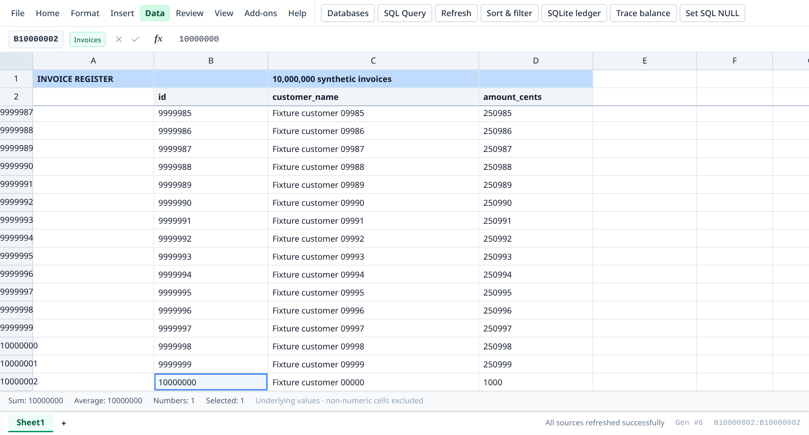
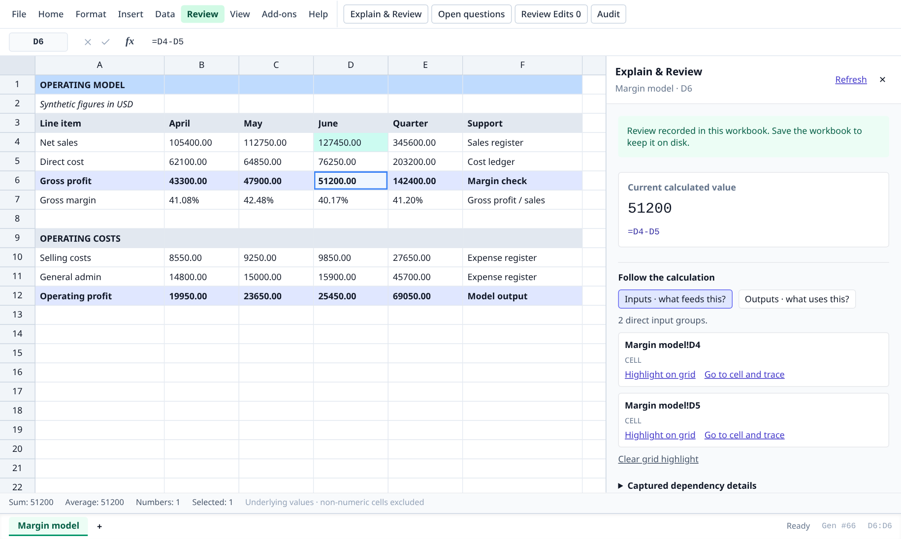

# Tayriva

**Work with millions of rows. Show where the numbers come from.**

Tayriva (formerly Gridloom) is a local-first spreadsheet for financial models and accounting work. Browse a live database table without importing every row. Then audit a calculation in the same workbook, from the result back to its inputs.

[Website](https://tayriva.lhemerly.chatgpt.site/) · [**Download Tayriva for Windows or Linux**](https://github.com/TayrivaHQ/tayriva/releases/latest) · [Quick start](https://github.com/TayrivaHQ/tayriva/blob/main/docs/INSTALL.md)

Tayriva uses **`.tay`** workbooks. Earlier Gridloom files are not supported, even if renamed.

## 10 million rows. No million-row wall.

Tayriva's live SQLite tables don't stop at [Excel's 1,048,576-row worksheet limit](https://support.microsoft.com/en-us/excel/excel-specifications-and-limits). Tayriva fetches the rows around your view instead of loading the full table. Filter and sort in SQL, then jump to the rows you need.

**First invoice to invoice 10,000,000 in 141 ms**, including rendering, in one local test on a synthetic SQLite dataset. [See how it was measured.](https://github.com/TayrivaHQ/tayriva/blob/main/docs/WORKBOOKS.md#live-table-performance-and-limits)

## 648× faster than Receita Federal’s own calculator

In a matched benchmark, Tayriva’s worksheet engine calculated and saved **10 million invoices in 34.30 seconds**. Brazil’s official Java reference took **6 hours, 10 minutes, 28 seconds**. All 10 million results matched to the cent. The test used a development build, one CPU core, and four synthetic CBS/IBS scenarios. [See the benchmark and method](https://github.com/TayrivaHQ/tayriva-demos/blob/main/receita/benchmark/matched-10m.md).

## Run one worksheet calculation across a SQLite table

Set up a worksheet template, then use **Data → Run formula batch** to calculate each input row and write back an auditable result snapshot. The batch never edits the source table. [Set up a formula batch](docs/worksheet-formula-batches.md).

## Audit the number, not just the formula

Pick a result and open **Review → Explain & Review**. Follow its inputs or see which formulas use it. Record what you checked, attach supporting evidence, or raise a question without losing the calculation it came from. If the calculation or a traced input changes, Tayriva marks the review stale, even if the displayed total stays the same.

## Give your agent a way to check its own work

The bundled headless MCP server lets an agent write a formula, compare the exact result with an independent calculation, trace and fix a mismatch, and record an AI-assisted review you can open in Tayriva. [Try the agent self-review walkthrough.](https://github.com/TayrivaHQ/tayriva/blob/main/docs/MCP.md)

## Try it with a real workbook

Start with [**The Total Still Ties**](https://github.com/TayrivaHQ/tayriva-demos/blob/main/workbooks/the-total-still-ties.tay). The control total is **$100.25**, but rent and software are swapped. Trace the amounts with **Explain & Review**, fix the two mappings, then record a review on the total. Move $1 from rent to software in the ledger: the total still ties, but the review goes stale because its inputs changed.

- [**Alphabet DCF**](https://github.com/TayrivaHQ/tayriva-demos/blob/main/workbooks/alphabet-fcff.tay): Trace an illustrative per-share value back through cash flows, the cost of capital, and SEC-filed figures.
- [**U.S. Treasury curve**](https://github.com/TayrivaHQ/tayriva-demos/blob/main/derivatives/treasury-snapshot.tay): Turn a dated set of public Treasury yields into modeled forward rates and a trade value.
- [**OIS swap**](https://github.com/TayrivaHQ/tayriva-demos/blob/main/derivatives/ois-swap.tay): Trace synthetic swap quotes through the discount curve to the price and its sensitivity to a rate change.

[Download the workbooks and follow the walkthroughs](https://github.com/TayrivaHQ/tayriva-demos). Open any of them in Tayriva using **File → Open**.

[Workbook guide](https://github.com/TayrivaHQ/tayriva/blob/main/docs/WORKBOOKS.md) · [Build from source](https://github.com/TayrivaHQ/tayriva/blob/main/docs/DEVELOPMENT.md) · [License](LICENSE)
